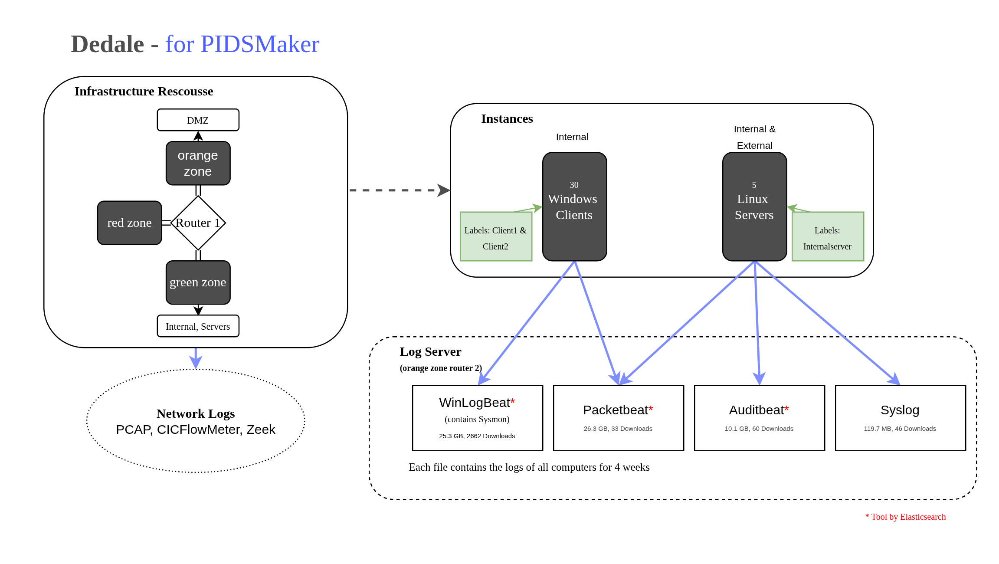

## Presentation
> f

## What this repo is about
Along the project assignment, this repo contains all the results and insights won during this course.  
The main task is the integration of new datasets in the PIDSMaker Framework. To achieve this, the implementation of new parser, handling different raw semi-structued data types, is required.  
#### *Properties of new datasets according to [scheme](https://www.sciencedirect.com/science/article/abs/pii/S0167404825001919)*

|  | [Aviator](https://radar.kit.edu/radar/en/dataset/8s5b0u5yqgfs2y0d) | [CyLab](https://gitlab.cylab.be/cylab/datasets/apt-persistence/-/tree/main) | [Dedale](https://entrepot.recherche.data.gouv.fr/dataset.xhtml?persistentId=doi:10.57745/Y5JLDG) |
|--------------|:-----------:|:---------:|:----------:|
| **GENERAL INFORMATION** ||||
| Data set name | AVIATOR: A MITRE Emulation Plan-Derived Living Dataset for Advanced Persistent Threat Detection and Investigation | APT Persistencee  | DEDALE: Dataset for Evaluating Detection of APT among Logs and Events |
| Release year | 2025 | 2024 (updated 2025) | 2026 |
| Web link | https://radar.kit.edu/radar/en/dataset/8s5b0u5yqgfs2y0d, https://ieeexplore.ieee.org/document/10826006 | https://gitlab.cylab.be/cylab/datasets/apt-persistence | https://entrepot.recherche.data.gouv.fr/dataset.xhtml?persistentId=doi:10.57745/Y5JLDG, https://dedale.inria.fr/index.html, https://link.springer.com/chapter/10.1007/978-3-032-16092-8_1 |
| Data parser link | not provided, meanwhile the paper says there exists one | [json](https://gitlab.cylab.be/cylab/datasets/apt-persistence/-/blob/main/Scripts/Evtx_To_Json.py?ref_type=heads)| n.i.f. (no information found) |
| **BEHAVIOR PATTERN** ||||
| Normal behavior | yes | yes | yes |
| Attack behavior | yes | yes | yes |
| Normal behavior type(s) | n.i.f. | different user profiles: developers, students, adminstrators, ... with different installed software  | compay with different use profiles doing: mailing, browsing, filing, ssh, system, vpn |
| Attack behavior type(s) | credential theft, domain credentials, e-mail (Mitre plans: APT29, Sandworm, Wizard-Spider and Oilrig) | n.i.f.| exfiltrate sensitive data: domain credentials of the users, internal documents  |
| Normal behavior execution | n.i.f. | script-based ([GHOST NPC](https://github.com/cmu-sei/GHOSTS)) | script-based ([Aura](https://gitlab.inria.fr/mlanvin/aura)) |
| Attack behavior execution | script-based (MITRE Attack framework) | script-based ([Atomic RED Team](https://github.com/redcanaryco/atomic-red-team), Caldera, Metasploit) | script-based (MITRE Attack framework) |
| **RECORDING ENVIRONMENT** ||||
| Recorded data sources | authentication, logon, system, application | system and network logs |
| Type of network | enterprise/IT + operational technology + field device network | small network | [small network](https://dedale.inria.fr/rescousse.html) |
| Recording setup | emulated | emulated | emulated  |
| Data set recording tool(s) | Auditbeat, Filebeat, Winlogbeat (Sysmon + Windows Security Logs) | Sysmon | [System: Winlogbeat, Syslog, Auditbeat, Packetbeat Network: Zeek, CICFlowMeter](https://dedale.inria.fr/download.html) |
| **NATURE OF DATA** ||||
| Data set labels | yes (indirect) | yes (indirect) | yes (indirect)|
| Labeling instance | script-based (folders with Mitre emulation plans) | script-based | [script-based](https://gitlab.inria.fr/mlanvin/dedale_labeling) |
| Ratio normal/attack behavior | n.i.f. | 2 : 1 | 3 week benign activity : 1 week attack |
| Pre-defined data splits | yes (respective emulation plans) | yes (clean, infected) | yes (weeks) |
| Anonymity | n.i.f. | n.i.f. | n.i.f.|
| Truncation | n.i.f. | n.i.f | n.i.f. |
| **DATA VOLUME** ||||
| Data recording duration | 2 weeks | n.i.f. | 4 weeks |
| Data set size | 1.9 TB | 14.7GB | 2.9 TB  |
| Count recorded host machines | 12 | n.i.f | n.i.f |

## How this repo is structured
You can find all steps of this work in this repo. Starting from setting up the enviroment, to running own experiments with the own parsed experiments. In each step you can find at least one README documenting all the things that are relevant such as the design process and the concrete implementations and commands. 

